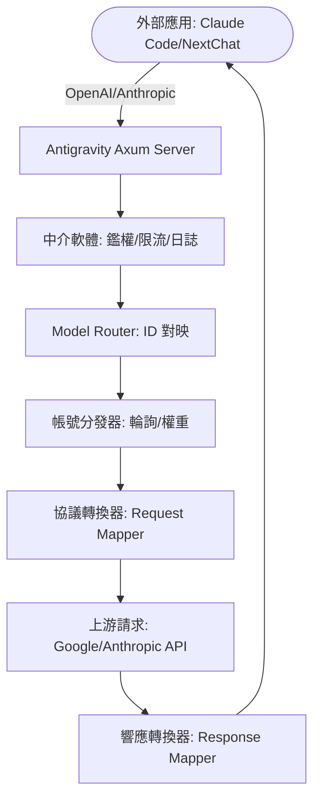

# Antigravity Tools 🚀
> 專業級 AI 帳號管理與協議代理系統 (v5.0.0)

<div align="center">
  
  <h3>Antigravity Tools</h3>
  <p>多平臺自動化運維與多帳號矩陣排程控制檯</p>

  <p>
    <a href="https://github.com/lbjlaq/Antigravity-Manager/releases">
      
    </a>
    <a href="https://github.com/lbjlaq/Antigravity-Manager">
      
    </a>
    
    
  </p>

  <p>
    <a href="#-核心功能">核心功能</a> • 
    <a href="#-介面導覽">介面導覽</a> • 
    <a href="#-技術架構">技術架構</a> • 
    <a href="#-安裝指南">安裝指南</a> • 
    <a href="#-快速接入">快速接入</a>
  </p>

  <p>
    <strong>繁體中文</strong> | 
    <a href="./README_EN.md">English</a>
  </p>
</div>

---

**Antigravity Tools** 是一個專為開發者和 AI 愛好者設計的全功能桌面應用。它將多帳號管理、協議轉換和智慧請求排程完美結合，為您提供一個穩定、極速且成本低廉的 **本地 AI 中轉站**。

透過本應用，您可以將常見的 Web 端 Session (Google/Anthropic) 轉化為標準化的 API 介面，消除不同廠商間的協議鴻溝。

## 🌟 深度功能解析 (Detailed Features)

### 1. 🎛️ 智慧帳號儀表盤 (Smart Dashboard)
*   **全域性實時監控**: 一眼洞察所有帳號的健康狀況，包括 Gemini Pro、Gemini Flash、Claude 以及 Gemini 繪圖的 **平均剩餘配額**。
*   **最佳帳號推薦 (Smart Recommendation)**: 系統會根據當前所有帳號的配額冗餘度，實時演算法篩選並推薦“最佳帳號”，支援 **一鍵切換**。
*   **活躍帳號快照**: 直觀顯示當前活躍帳號的具體配額百分比及最後同步時間。

### 2. 🔐 強大的帳號管家 (Account Management)
*   **OAuth 2.0 授權（自動/手動）**: 新增帳號時會提前生成可複製的授權連結，支援在任意瀏覽器完成授權；回撥成功後應用會自動完成並儲存（必要時可點選“我已授權，繼續”手動收尾）。
*   **多維度匯入**: 支援單條 Token 錄入、JSON 批次匯入（如來自其他工具的備份），以及從 V1 舊版本資料庫自動熱遷移。
*   **閘道器級檢視**: 支援“列表”與“網格”雙檢視切換。提供 403 封禁檢測，自動標註並跳過權限異常的帳號。

### 3. 🔌 協議轉換與中繼 (API Proxy)
*   **全協議適配 (Multi-Sink)**:
    *   **OpenAI 格式**: 提供 `/v1/chat/completions` 端點，相容 99% 的現有 AI 應用。
    *   **Anthropic 格式**: 提供原生 `/v1/messages` 介面，支援 **Claude Code CLI** 的全功能（如思思維鏈、系統提示詞）。
    *   **Gemini 格式**: 支援 Google 官方 SDK 直接呼叫。
*   **智慧狀態自愈**: 當請求遇到 `429 (Too Many Requests)` 或 `401 (Expire)` 時，後端會毫秒級觸發 **自動重試與靜默輪換**，確保業務不中斷。

### 4. 🔀 模型路由中心 (Model Router)
*   **系列化對映**: 您可以將複雜的原始模型 ID 歸類到“規格家族”（如將所有 GPT-4 請求統一路由到 `gemini-3-pro-high`）。
*   **專家級重定向**: 支援自定義正規表示式級模型對映，精準控制每一個請求的落地模型。
*   **智慧分級路由 (Tiered Routing)**: [新] 系統根據帳號型別（Ultra/Pro/Free）和配額重置頻率自動優先順序排序，優先消耗高速重置帳號，確保高頻呼叫下的服務穩定性。
*   **後臺任務靜默降級**: [新] 自動識別 Claude CLI 等工具生成的後臺請求（如標題生成），智慧重定向至 Flash 模型，保護高階模型配額不被浪費。

### 5. 🎨 多模態與 Imagen 3 支援
*   **高階畫質控制**: 支援透過 OpenAI `size` (如 `1024x1024`, `16:9`) 引數自動對映到 Imagen 3 的相應規格。
*   **超強 Body 支援**: 後端支援高達 **100MB** (可配置) 的 Payload，處理 4K 高畫質圖識別綽綽有餘。

## 📸 介面導覽 (GUI Overview)

| | |
| :---: | :---: |
|  <br> 儀表盤 |  <br> 帳號列表 |
|  <br> 關於頁面 |  <br> API 反代 |
|  <br> 系統設定 | |

### 💡 使用案例 (Usage Examples)

| | |
| :---: | :---: |
|  <br> Claude Code 聯網搜尋 |  <br> Cherry Studio 深度整合 |
|  <br> Imagen 3 高階繪圖 |  <br> Kilo Code 接入 |

## 🏗️ 技術架構 (Architecture)



##  安裝指南 (Installation)

### 選項 A: 終端安裝 (推薦)

**Windows (PowerShell):**
```powershell
irm https://raw.githubusercontent.com/SanHsien/Antigravity-Manager/main/install.ps1 | iex
```

### 選項 B: 手動下載
前往 [GitHub Releases](https://github.com/SanHsien/Antigravity-Manager/releases) 下載 Windows 安裝包：
*   **Windows**: `.exe` (NSIS 安裝包) 或 `.msi`


## 🔌 快速接入示例

### 🔐 OAuth 授權流程（新增帳號）
1. 開啟“Accounts / 帳號” → “新增帳號” → “OAuth”。
2. 彈窗會在點選按鈕前預生成授權連結；點選連結即可複製到系統剪貼簿，然後用你希望的瀏覽器開啟並完成授權。
3. 授權完成後瀏覽器會開啟本地回撥頁並顯示“✅ 授權成功!”。
4. 應用會自動繼續完成授權並儲存帳號；如未自動完成，可點選“我已授權，繼續”手動完成。

> 提示：授權連結包含一次性回撥埠，請始終使用彈窗裡生成的最新連結；如果授權時應用未執行或彈窗已關閉，瀏覽器可能會提示 `localhost refused connection`。

### 如何接入 Claude Code CLI?
1.  啟動 Antigravity，並在“API 反代”頁面開啟服務。
2.  在終端執行：
```bash
export ANTHROPIC_API_KEY="sk-antigravity"
export ANTHROPIC_BASE_URL="http://127.0.0.1:8045"
claude
```

### 如何接入 OpenCode?
1.  進入 **API 反代**頁面 → **外部 Providers** → 點選 **OpenCode Sync** 卡片。
2.  點選 **Sync** 按鈕，將自動生成 `~/.config/opencode/opencode.json` 配置檔案：
    - 建立獨立 provider `antigravity-manager`（不覆蓋 google/anthropic 原生配置）
    - 可選：勾選 **Sync accounts** 匯出 `antigravity-accounts.json`（plugin-compatible v3 格式），供 OpenCode 外掛直接匯入
3.  點選 **Clear Config** 可一鍵清除 Manager 配置並清理 legacy 殘留；點選 **Restore** 可從備份恢復。
4.  Windows 使用者路徑為 `C:\Users\<使用者名稱>\.config\opencode\`（與 `~/.config/opencode` 規則一致）。

**快速驗證命令：**
```bash
# 測試 antigravity-manager provider（支援 --variant）
opencode run "test" --model antigravity-manager/claude-sonnet-4-5-thinking --variant high

# 若已安裝 opencode-antigravity-auth 外掛，驗證 google provider 仍可獨立工作
opencode run "test" --model google/antigravity-claude-sonnet-4-5-thinking --variant max
```

### 如何接入 Kilo Code?
1.  **協議選擇**: 建議優先使用 **Gemini 協議**。
2.  **Base URL**: 填寫 `http://127.0.0.1:8045`。
3.  **注意**: 
    - **OpenAI 協議限制**: Kilo Code 在使用 OpenAI 模式時，其請求路徑會疊加產生 `/v1/chat/completions/responses` 這種非標準路徑，導致 Antigravity 返回 404。因此請務必填入 Base URL 後選擇 Gemini 模式。
    - **模型對映**: Kilo Code 中的模型名稱可能與 Antigravity 預設設定不一致，如遇到無法連線，請在“模型對映”頁面設定自定義對映，並檢視**日誌檔案**進行除錯。

### 如何在 Python 中使用?
```python
import openai

client = openai.OpenAI(
    api_key="sk-antigravity",
    base_url="http://127.0.0.1:8045/v1"
)

response = client.chat.completions.create(
    model="gemini-3-flash",
    messages=[{"role": "user", "content": "你好，請自我介紹"}]
)
print(response.choices[0].message.content)
```

### 如何使用圖片生成 (Imagen 3)?

#### 方式一：OpenAI Images API (推薦)
```python
import openai

client = openai.OpenAI(
    api_key="sk-antigravity",
    base_url="http://127.0.0.1:8045/v1"
)

# 生成圖片
response = client.images.generate(
    model="gemini-3-pro-image",
    prompt="一座未來主義風格的城市，賽博朋克，霓虹燈",
    size="1920x1080",      # 支援任意 WIDTHxHEIGHT 格式，自動計算寬高比
    quality="hd",          # "standard" | "hd" | "medium"
    n=1,
    response_format="b64_json"
)

# 儲存圖片
import base64
image_data = base64.b64decode(response.data[0].b64_json)
with open("output.png", "wb") as f:
    f.write(image_data)
```

**支援的引數**：
- **`size`**: 任意 `WIDTHxHEIGHT` 格式（如 `1280x720`, `1024x1024`, `1920x1080`），自動計算並對映到標準寬高比（21:9, 16:9, 9:16, 4:3, 3:4, 1:1）
- **`quality`**: 
  - `"hd"` → 4K 解析度（高質量）
  - `"medium"` → 2K 解析度（中等質量）
  - `"standard"` → 預設解析度（標準質量）
- **`n`**: 生成圖片數量（1-10）
- **`response_format`**: `"b64_json"` 或 `"url"`（Data URI）

<details>
<summary><b>🎨 展開檢視更多圖片呼叫方式與引數對映規則 (Chat API / 模型字尾 / Cherry Studio)</b></summary>

#### 方式二：Chat API + 引數設定 (✨ 新增)

**所有協議**（OpenAI、Claude）的 Chat API 現在都支援直接傳遞 `size` 和 `quality` 引數：

```python
# OpenAI Chat API
response = client.chat.completions.create(
    model="gemini-3-pro-image",
    size="1920x1080",      # ✅ 支援任意 WIDTHxHEIGHT 格式
    quality="hd",          # ✅ "standard" | "hd" | "medium"
    messages=[{"role": "user", "content": "一座未來主義風格的城市"}]
)
```

```bash
# Claude Messages API
curl -X POST http://127.0.0.1:8045/v1/messages \
  -H "Content-Type: application/json" \
  -H "x-api-key: sk-antigravity" \
  -d '{
    "model": "gemini-3-pro-image",
    "size": "1280x720",
    "quality": "hd",
    "messages": [{"role": "user", "content": "一隻可愛的貓咪"}]
  }'
```

**引數優先順序**: `imageSize` 引數 > `quality` 引數 > 模型字尾

**✨ 新增 `imageSize` 引數支援**:

除了 `quality` 引數外，現在還支援直接使用 Gemini 原生的 `imageSize` 引數:

```python
# 使用 imageSize 引數(最高優先順序)
response = client.chat.completions.create(
    model="gemini-3-pro-image",
    size="16:9",           # 寬高比
    imageSize="4K",        # ✨ 直接指定解析度: "1K" | "2K" | "4K"
    messages=[{"role": "user", "content": "一座未來主義風格的城市"}]
)
```

```bash
# Claude Messages API 也支援 imageSize
curl -X POST http://127.0.0.1:8045/v1/messages \
  -H "Content-Type: application/json" \
  -H "x-api-key: sk-antigravity" \
  -d '{
    "model": "gemini-3-pro-image",
    "size": "1280x720",
    "imageSize": "4K",
    "messages": [{"role": "user", "content": "一隻可愛的貓咪"}]
  }'
```

**引數說明**:
- **`imageSize`**: 直接指定解析度 (`"1K"` / `"2K"` / `"4K"`)
- **`quality`**: 透過質量等級推斷解析度 (`"standard"` → 1K, `"medium"` → 2K, `"hd"` → 4K)
- **優先順序**: 如果同時指定 `imageSize` 和 `quality`, 系統會優先使用 `imageSize`

#### 方式三：Chat 介面 + 模型字尾
```python
response = client.chat.completions.create(
    model="gemini-3-pro-image-16-9-4k",  # 格式：gemini-3-pro-image-[比例]-[質量]
    messages=[{"role": "user", "content": "一座未來主義風格的城市"}]
)
```

**模型字尾說明**：
- **寬高比**: `-16-9`, `-9-16`, `-4-3`, `-3-4`, `-21-9`, `-1-1`
- **質量**: `-4k` (4K), `-2k` (2K), 不加字尾（標準）
- **示例**: `gemini-3-pro-image-16-9-4k` → 16:9 比例 + 4K 解析度

#### 方式四：Cherry Studio 等客戶端設定
在支援 OpenAI 協議的客戶端（如 Cherry Studio）中，可以透過**模型設定**頁面配置圖片生成引數：

1. **進入模型設定**：選擇 `gemini-3-pro-image` 模型
2. **配置引數**：
   - **Size (尺寸)**: 輸入任意 `WIDTHxHEIGHT` 格式（如 `1920x1080`, `1024x1024`）
   - **Quality (質量)**: 選擇 `standard` / `hd` / `medium`
   - **Number (數量)**: 設定生成圖片數量（1-10）
3. **傳送請求**：直接在對話方塊中輸入圖片描述即可

**引數對映規則**：
- `size: "1920x1080"` → 自動計算為 `16:9` 寬高比
- `quality: "hd"` → 對映為 `4K` 解析度
- `quality: "medium"` → 對映為 `2K` 解析度

</details>

## 📝 更新日誌

> 最新版本 **v4.8.2**（2026-10-16）：修復 Windows MSVC 環境下 Common Controls v6 清單依賴與測試二進位檔載入異常；新增 Windows 載入診斷工具；Gemini 中轉保底填充文字調整為純協定標點 `.` 避免干擾模型分析推理；同步審查上游 issue #3681、#3682 與 #3683，確認原生支援 MCP 工具之遞迴 `const` 關鍵字規範化。

👉 **[檢視完整更新日誌 CHANGELOG.md →](CHANGELOG.md)**

<details>
<summary><b>👥 核心貢獻者 (Contributors) - 點選展開</b></summary>

感謝所有為本專案付出汗水與智慧的開發者，完整名單請見上游倉庫的 [Contributors 頁面](https://github.com/lbjlaq/Antigravity-Manager/graphs/contributors)。

</details>

<details>
<summary><b>🤝 鳴謝專案 (Special Thanks) - 點選展開</b></summary>

本專案在開發過程中參考或借鑑了以下優秀開源專案的思路或程式碼，排名不分先後：

*   [learn-claude-code](https://github.com/shareAI-lab/learn-claude-code)
*   [Practical-Guide-to-Context-Engineering](https://github.com/WakeUp-Jin/Practical-Guide-to-Context-Engineering)
*   [CLIProxyAPI](https://github.com/router-for-me/CLIProxyAPI)
*   [OmniRoute](https://github.com/diegosouzapw/OmniRoute)
*   [antigravity-claude-proxy](https://github.com/badrisnarayanan/antigravity-claude-proxy)
*   [aistudio-gemini-proxy](https://github.com/zhongruichen/aistudio-gemini-proxy)
*   [gcli2api](https://github.com/su-kaka/gcli2api)
*   [agent-vibes](https://github.com/funny-vibes/agent-vibes)

</details>

*   **版權許可**: 基於 **CC BY-NC-SA 4.0** 許可，**嚴禁任何形式的商業行為**。
*   **安全聲明**: 本應用所有帳號資料加密儲存於本地 SQLite 資料庫，除非開啟同步功能，否則資料絕不離開您的裝置。

---

<div align="center">
  <p>本專案 fork 自 <a href="https://github.com/lbjlaq/Antigravity-Manager">lbjlaq/Antigravity-Manager</a>，依 CC BY-NC-SA 4.0 授權。</p>
</div>
