# Antigravity Tools 🚀
> Professional Account Management & Protocol Proxy System for AI Services (v4.9.0)

<div align="center">
  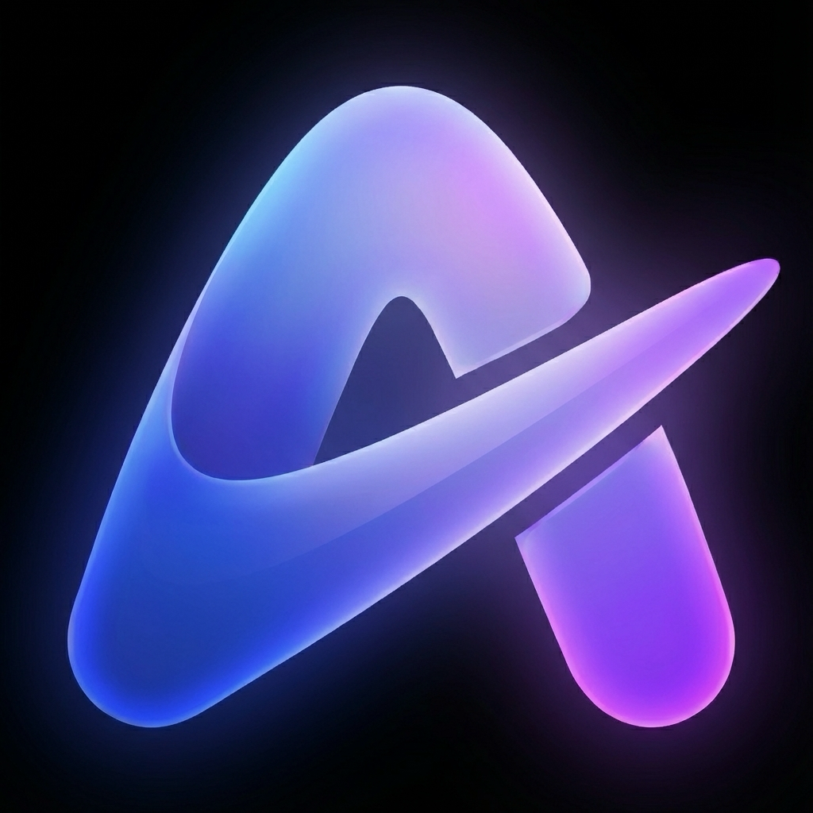
  <h3>Antigravity Tools</h3>
  <p>Multi-platform automation & multi-account matrix dispatch console</p>

  <p>
    <a href="https://github.com/lbjlaq/Antigravity-Manager/releases">
      
    </a>
    <a href="https://github.com/lbjlaq/Antigravity-Manager">
      
    </a>
    
    
    
    
  </p>

  <p>
    <a href="#-features">Features</a> • 
    <a href="#-gui-overview">GUI Overview</a> • 
    <a href="#-architecture">Architecture</a> • 
    <a href="#-installation">Installation</a> • 
    <a href="#-quick-integration">Integration</a>
  </p>

  <p>
    <a href="./README.md">繁體中文</a> | 
    <strong>English</strong>
  </p>
</div>

---

**Antigravity Tools** is an all-in-one desktop application designed for developers and AI enthusiasts. It perfectly combines multi-account management, protocol conversion, and smart request scheduling to provide you with a stable, high-speed, and low-cost **Local AI Relay Station**.

By leveraging this app, you can transform common Web Sessions (Google/Anthropic) into standardized API interfaces, completely eliminating the protocol gap between different providers.

## 🌟 Detailed Feature Matrix

### 1. 🎛️ Smart Account Dashboard
*   **Global Real-time Monitoring**: Instant insight into the health of all accounts, including average remaining quotas for Gemini Pro, Gemini Flash, Claude, and Gemini Image generation.
*   **Smart Recommendation**: The system uses a real-time algorithm to filter and recommend the "Best Account" based on quota redundancy, supporting **one-click switching**.
*   **Active Account Snapshot**: Visually displays the specific quota percentage and the last synchronization time of the currently active account.

### 2. 🔐 Professional AI Account Management & Proxy System
*   **OAuth 2.0 Authorization (Auto/Manual)**: Pre-generates a copyable authorization URL so you can finish auth in any browser; after the callback, the app auto-completes and saves the account (use “I already authorized, continue” if needed).
*   **Multi-dimensional Import**: Supports single token entry, JSON batch import, and automatic hot migration from V1 legacy databases.
*   **Gateway-level Views**: Supports switching between "List" and "Grid" views. Provides 403 Forbidden detection, automatically marking and skipping accounts with permission anomalies.

### 3.  Protocol Conversion & Relay (API Proxy)
*   **Multi-Protocol Adaptation (Multi-Sink)**:
    *   **OpenAI Format**: Provides `/v1/chat/completions` endpoint, compatible with 99% of existing AI apps.
    *   **Anthropic Format**: Provides native `/v1/messages` interface, supporting all features of **Claude Code CLI** (e.g., chain-of-thought, system prompts).
    *   **Gemini Format**: Supports direct calls from official Google AI SDKs.
*   **Smart Self-healing**: When a request encounters `429 (Too Many Requests)` or `401 (Expired)`, the backend triggers **millisecond-level automatic retry and silent rotation**, ensuring business continuity.

### 4. 🔀 Model Router Center
*   **Series-based Mapping**: Classify complex original model IDs into "Series Groups" (e.g., routing all GPT-4 requests uniformly to `gemini-3-pro-high`).
*   **Expert Redirection**: Supports custom regex-level model mapping for precise control over every request's landing model.
*   **Tiered Routing [New]**: Automatically prioritizes models based on account tiers (Ultra/Pro/Free) and reset frequencies to ensure stability for high-volume users.
*   **Silent Background Downgrading [New]**: Intelligently identifies background tasks (e.g., Claude CLI title generation) and reroutes them to Flash models to preserve premium quota.

### 5. 🎨 Multimodal & Imagen 3 Support
*   **Advanced Image Control**: Supports precise control over image generation tasks via OpenAI `size` (e.g., `1024x1024`, `16:9`) parameters or model name suffixes.
*   **Enhanced Payload Support**: The backend supports payloads up to **100MB** (configurable), more than enough for 4K HD image recognition and processing.

##  GUI Overview

| | |
| :---: | :---: |
| 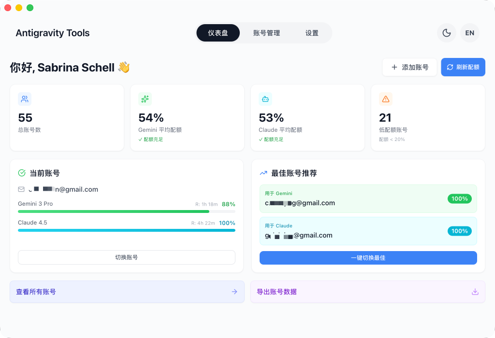 <br> Dashboard | 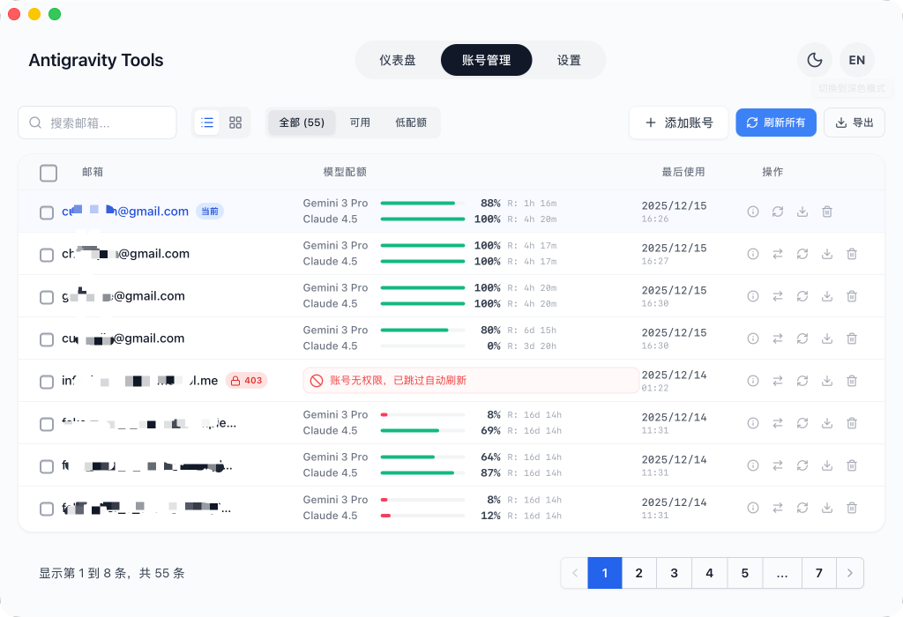 <br> Account List |
| 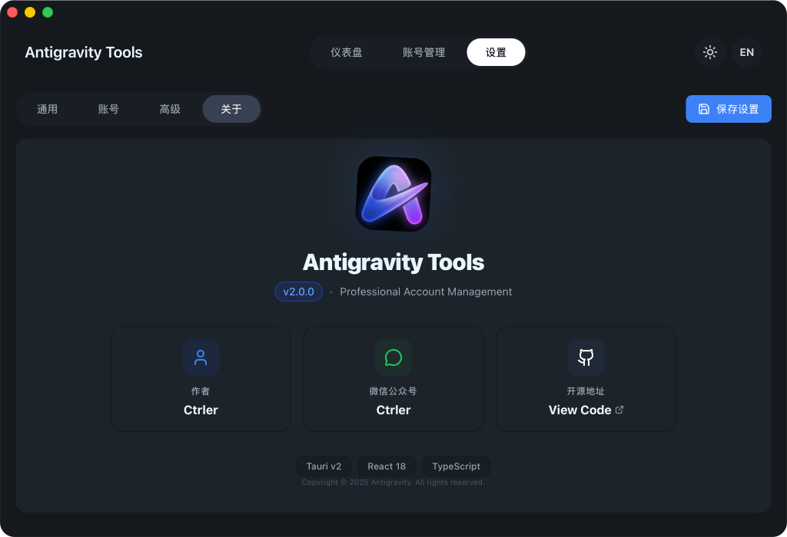 <br> About Page | 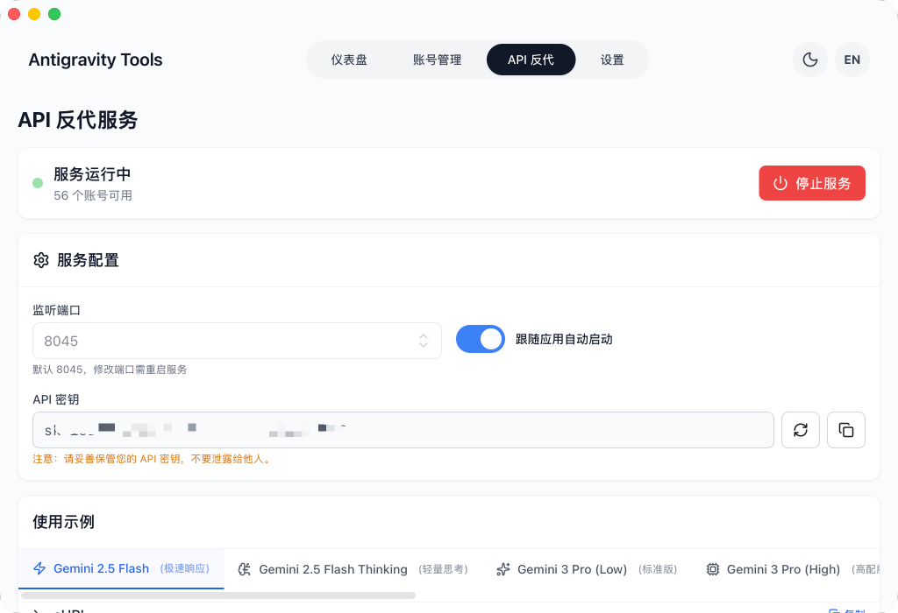 <br> API Proxy |
| 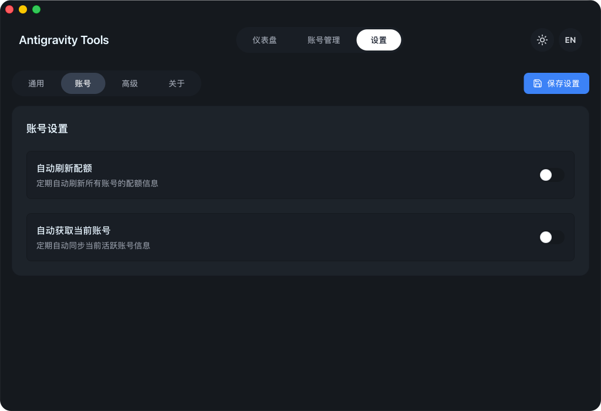 <br> Settings | |

### 💡 Usage Examples

| | |
| :---: | :---: |
| 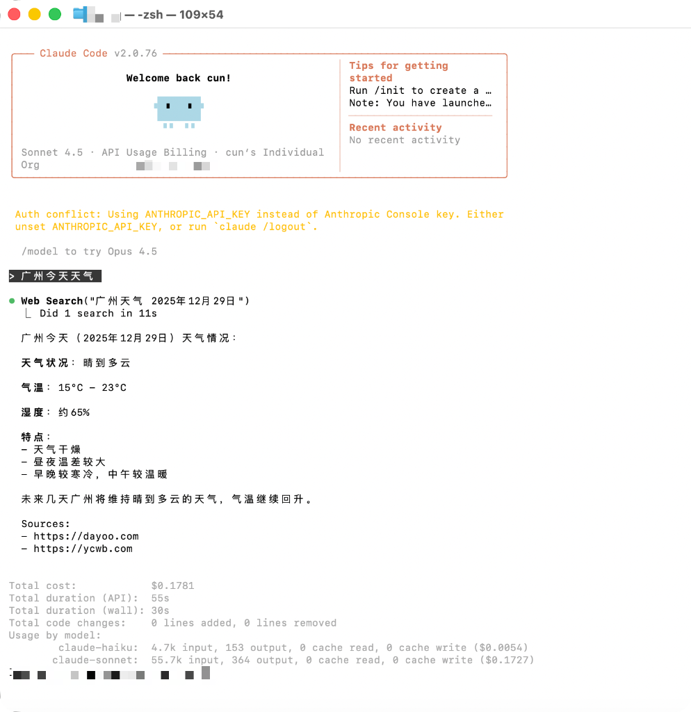 <br> Claude Code Web Search | 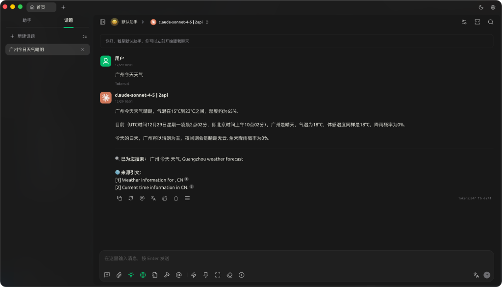 <br> Cherry Studio Integration |
| 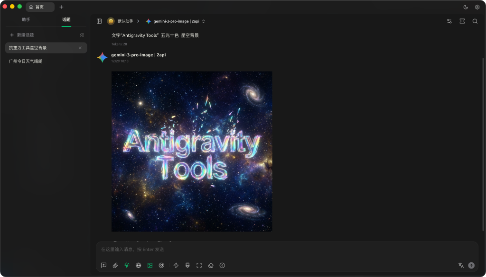 <br> Imagen 3 Advanced Drawing | 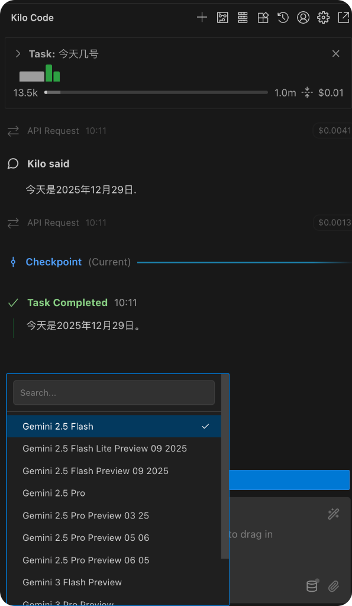 <br> Kilo Code Integration |

## 🏗️ Architecture

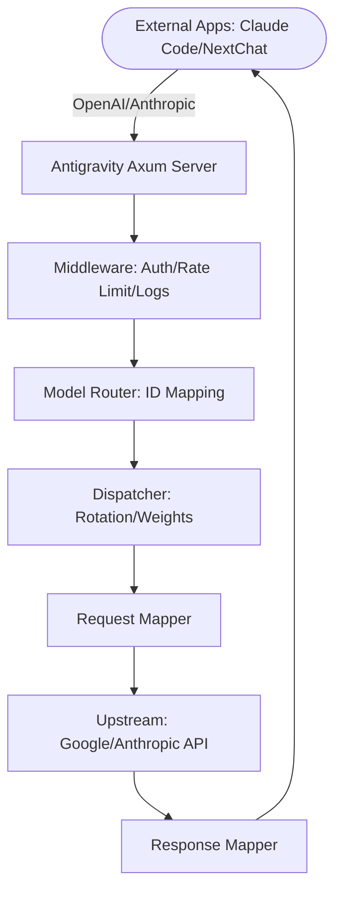

## 📥 Installation

### Option A: Terminal Installation (Recommended)

**Windows (PowerShell):**
```powershell
irm https://raw.githubusercontent.com/SanHsien/Antigravity-Manager/main/install.ps1 | iex
```

### Option B: Manual Download
Download from [GitHub Releases](https://github.com/SanHsien/Antigravity-Manager/releases):
*   **Windows**: `.exe` (NSIS installer) or `.msi`


## 🔌 Quick Integration Examples

### 🔐 OAuth Authorization Flow (Add Account)
1. Go to `Accounts` → `Add Account` → `OAuth`.
2. The dialog pre-generates an authorization URL before you click any button. Click the URL to copy it to the system clipboard, then open it in the browser you prefer and complete authorization.
3. After consent, the browser opens a local callback page and shows “✅ Authorized successfully!”.
4. The app automatically continues the flow and saves the account; if it doesn’t, click “I already authorized, continue” to finish manually.

> Note: the auth URL contains a one-time local callback port. Always use the latest URL shown in the dialog. If the app isn’t running or the dialog is closed during auth, the browser may show `localhost refused connection`.

### How to use with Claude Code CLI?
1. Start Antigravity service in the "API Proxy" tab.
2. In your terminal:
```bash
export ANTHROPIC_API_KEY="sk-antigravity"
export ANTHROPIC_BASE_URL="http://127.0.0.1:8045"
claude
```

### How to use with OpenCode?
1. Go to **API Proxy** → **External Providers** → click the **OpenCode Sync** card.
2. Click **Sync** to generate `~/.config/opencode/opencode.json`:
    - Creates a dedicated provider `antigravity-manager` (does not overwrite google/anthropic providers)
    - Optional: Check **Sync accounts** to export `antigravity-accounts.json` (plugin-compatible v3 format) for the OpenCode plugin
3. Click **Clear Config** to remove Manager configuration and clean up legacy entries; click **Restore** to revert from backup.
4. On Windows, the path is `C:\Users\<User>\.config\opencode\` (same `~/.config/opencode` rule).

**Quick verification commands:**
```bash
# Test antigravity-manager provider (supports --variant)
opencode run "test" --model antigravity-manager/claude-sonnet-4-5-thinking --variant high

# If opencode-antigravity-auth is installed, verify google provider still works independently
opencode run "test" --model google/antigravity-claude-sonnet-4-5-thinking --variant max
```

### How to use in Python?
```python
import openai

client = openai.OpenAI(
    api_key="sk-antigravity",
    base_url="http://127.0.0.1:8045/v1"
)

response = client.chat.completions.create(
    model="gemini-3-flash",
    messages=[{"role": "user", "content": "Hello, please introduce yourself"}]
)
print(response.choices[0].message.content)
```

### How to use with Kilo Code?
1.  **Protocol Selection**: We recommend using the **Gemini protocol**.
2.  **Base URL**: Set it to `http://127.0.0.1:8045`.
3.  **Note**: 
    - **OpenAI Protocol Limitation**: When using OpenAI mode, Kilo Code's request path will append `/v1/chat/completions/responses`, a non-standard path that will return 404 from Antigravity. Make sure to enter the Base URL and select Gemini mode.
    - **Model Mapping**: Model names in Kilo Code may differ from Antigravity's defaults. If you encounter connection issues, set up custom mappings on the "Model Mapping" page and check the **log files** for debugging.

### How to use Image Generation (Imagen 3)?

#### Method 1: OpenAI Images API (Recommended)
```python
import openai

client = openai.OpenAI(
    api_key="***",
    base_url="http://127.0.0.1:8045/v1"
)

# Generate image
response = client.images.generate(
    model="gemini-3-pro-image",
    prompt="A futuristic cyberpunk city with neon lights",
    size="1920x1080",      # Supports any WIDTHxHEIGHT format, auto-calculates aspect ratio
    quality="hd",          # "standard" | "hd" | "medium"
    n=1,
    response_format="b64_json"
)

# Save image
import base64
image_data = base64.b64decode(response.data[0].b64_json)
with open("output.png", "wb") as f:
    f.write(image_data)
```

**Supported parameters**：
- **`size`**: Any `WIDTHxHEIGHT` format (e.g. `1280x720`, `1024x1024`, `1920x1080`), auto-calculates and maps to standard aspect ratios (21:9, 16:9, 9:16, 4:3, 3:4, 1:1)
- **`quality`**: 
  - `"hd"` → 4K resolution (high quality)
  - `"medium"` → 2K resolution (medium quality)
  - `"standard"` → Default resolution (standard quality)
- **`n`**: Number of images to generate (1-10)
- **`response_format`**: `"b64_json"` or `"url"` (Data URI)

<details>
<summary><b>🎨 Expand to view more image generation methods & parameter mapping rules (Chat API / Model Suffix / Cherry Studio)</b></summary>

#### Method 2: Chat API + Parameters (✨ New)

**All protocols** (OpenAI, Claude) Chat APIs now support direct `size` and `quality` parameters:

```python
# OpenAI Chat API
response = client.chat.completions.create(
    model="gemini-3-pro-image",
    size="1920x1080",      # ✅ Supports any WIDTHxHEIGHT format
    quality="hd",          # ✅ "standard" | "hd" | "medium"
    messages=[{"role": "user", "content": "A futuristic city"}]
)
```

```bash
# Claude Messages API
curl -X POST http://127.0.0.1:8045/v1/messages \
  -H "Content-Type: application/json" \
  -H "x-api-key: ***" \
  -d '{
    "model": "gemini-3-pro-image",
    "size": "1280x720",
    "quality": "hd",
    "messages": [{"role": "user", "content": "A cute cat"}]
  }'
```

**Parameter priority**: `imageSize` parameter > `quality` parameter > model suffix

**✨ New `imageSize` parameter support**:

In addition to the `quality` parameter, you can now also use Gemini's native `imageSize` parameter:

```python
# Using imageSize parameter (highest priority)
response = client.chat.completions.create(
    model="gemini-3-pro-image",
    size="16:9",           # Aspect ratio
    imageSize="4K",        # ✨ Direct resolution: "1K" | "2K" | "4K"
    messages=[{"role": "user", "content": "A futuristic city"}]
)
```

```bash
# Claude Messages API also supports imageSize
curl -X POST http://127.0.0.1:8045/v1/messages \
  -H "Content-Type: application/json" \
  -H "x-api-key: ***" \
  -d '{
    "model": "gemini-3-pro-image",
    "size": "1280x720",
    "imageSize": "4K",
    "messages": [{"role": "user", "content": "A cute cat"}]
  }'
```

**Parameter descriptions**:
- **`imageSize`**: Direct resolution specification (`"1K"` / `"2K"` / `"4K"`)
- **`quality`**: Infers resolution from quality level (`"standard"` → 1K, `"medium"` → 2K, `"hd"` → 4K)
- **Priority**: If both `imageSize` and `quality` are specified, the system prioritizes `imageSize`

#### Method 3: Chat API + Model Suffix
```python
response = client.chat.completions.create(
    model="gemini-3-pro-image-16-9-4k",  # Format: gemini-3-pro-image-[ratio]-[quality]
    messages=[{"role": "user", "content": "A futuristic city"}]
)
```

**Model suffix explanation**：
- **Aspect ratio**: `-16-9`, `-9-16`, `-4-3`, `-3-4`, `-21-9`, `-1-1`
- **Quality**: `-4k` (4K), `-2k` (2K), no suffix (standard)
- **Example**: `gemini-3-pro-image-16-9-4k` → 16:9 ratio + 4K resolution

#### Method 4: Cherry Studio & Other Client Settings
In clients that support OpenAI protocol (e.g., Cherry Studio), you can configure image generation parameters via the **Model Settings** page:

1. **Enter Model Settings**: Select the `gemini-3-pro-image` model
2. **Configure Parameters**:
   - **Size**: Enter any `WIDTHxHEIGHT` format (e.g. `1920x1080`, `1024x1024`)
   - **Quality**: Choose `standard` / `hd` / `medium`
   - **Number**: Set the number of images (1-10)
3. **Send Request**: Simply type your image description in the chat dialog

**Parameter mapping rules**:
- `size: "1920x1080"` → Auto-calculated as `16:9` aspect ratio
- `quality: "hd"` → Mapped to `4K` resolution
- `quality: "medium"` → Mapped to `2K` resolution

</details>

## 📝 Changelog

> Latest version **v4.8.2** (2026-10-16): Fixed Common Controls v6 manifest dependency and unit test binary loader failures on Windows MSVC; added Windows loader diagnostic tool; replaced Gemini defense fallback text with neutral dot `.` to prevent interference with model reasoning trajectories; triaged upstream issues #3681, #3682 and #3683, confirming native recursive `const` to `enum` normalization for MCP tools.

👉 **[View Full Changelog → CHANGELOG_EN.md](CHANGELOG_EN.md)**

<details>
<summary><b>👥 Contributors - Click to expand</b></summary>

Thanks to everyone who has contributed effort and ideas to this project. For the full list, see the upstream repository's [Contributors page](https://github.com/lbjlaq/Antigravity-Manager/graphs/contributors).

</details>

<details>
<summary><b>🤝 Special Thanks - Click to expand</b></summary>

This project has referenced or learned from the ideas or code of the following excellent open-source projects during its development (in no particular order):

*   [learn-claude-code](https://github.com/shareAI-lab/learn-claude-code)
*   [Practical-Guide-to-Context-Engineering](https://github.com/WakeUp-Jin/Practical-Guide-to-Context-Engineering)
*   [CLIProxyAPI](https://github.com/router-for-me/CLIProxyAPI)
*   [OmniRoute](https://github.com/diegosouzapw/OmniRoute)
*   [antigravity-claude-proxy](https://github.com/badrisnarayanan/antigravity-claude-proxy)
*   [aistudio-gemini-proxy](https://github.com/zhongruichen/aistudio-gemini-proxy)
*   [gcli2api](https://github.com/su-kaka/gcli2api)
*   [agent-vibes](https://github.com/funny-vibes/agent-vibes)

</details>

*   **License**: **CC BY-NC-SA 4.0**. Strictly for non-commercial use.
*   **Security**: All account data is encrypted and stored locally in a SQLite database. Data never leaves your device unless sync is enabled.

---

<div align="center">
  <p>This project is forked from <a href="https://github.com/lbjlaq/Antigravity-Manager">lbjlaq/Antigravity-Manager</a>, licensed under CC BY-NC-SA 4.0.</p>
</div>
